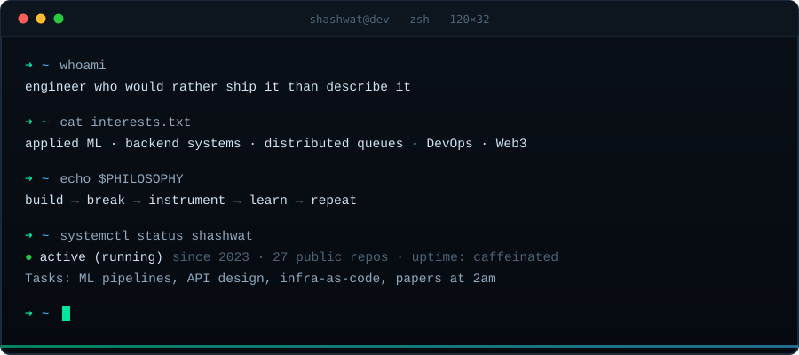

<!-- ===========================================================
     SHASH309 · GITHUB PROFILE
     Everything below is hand-built. The banner and the terminal
     are custom SVGs in ./assets — no template, no generator.
     =========================================================== -->

<div align="center">

<a href="https://shashwat-sharma-dev.vercel.app/">
  
</a>

<br/>

<a href="https://github.com/Shash309?tab=repositories">
  
</a>

<br/><br/>

<a href="https://shashwat-sharma-dev.vercel.app/"></a>
<a href="https://www.linkedin.com/in/shashwat-sharma-042950288"></a>
<a href="mailto:shashwatsharma309@gmail.com"></a>

</div>

---

### `~/about`

Final-year **B.Tech CSE (AI & ML)** at SRM IST · CGPA 8.52 · available immediately.

The work I keep coming back to lives in the gap between a model and somebody's actual problem. At **Tata Steel** that meant sitting with metallurgists until *"this bar looks wrong"* became features, validation criteria and an XGBoost classifier over 15,000+ TMT samples. The model was maybe a third of the job. The rest was translation — and that part turned out to be the part I'm good at.

At **Personate AI** it was the same instinct pointed at a product instead of a furnace: face unlock and liveness verification, 500K+ records through the inference pipeline, shipped as something users actually touched.

So: applied AI, leaning forward-deployed rather than purely research. I'll train the model, write the FastAPI service that serves it, provision the box it runs on — and then go argue with the domain expert about what the output should actually *say*. The interesting failures are in the seams between those layers, and you only find them if you own all of them.

Everything below is a repo nobody asked me to build. Attention implemented from scratch because I wanted to see the alignment heatmaps myself. A job queue from first principles because *two workers claimed the same row* teaches you more than a blog post about it ever will.

No "AI is the future" posting. Just things you can clone and run.

---

### `~/shipped --production`

| Where | What | Result |
|---|---|---|
| **Tata Steel** · `ML Engineer Intern` · `Nov 2025 – May 2026` | XGBoost quality assessment model over 15,000+ TMT bar samples, feature design done with domain experts | **+17% F1** on defect detection |
| **Personate AI** · `Data Science Intern` · `May – Jul 2025` | Face unlock + liveness verification · React · FastAPI · OpenCV · MediaPipe · 500K+ records | **+18% precision**, fed the product roadmap |

<sub>Oracle Cloud Infrastructure 2024 Certified Foundations Associate · Smart India Hackathon, Ministry of Education (2023)</sub>

---

### `~/now`

```console
➜ ~ ls -t ~/work | head -4

DevFlow/                   branch-aware CI/CD — Jenkins → Docker → AWS → CloudWatch
attention-translator/      seq2seq + Bahdanau attention, trained and benchmarked
vle7-app/                  containerised deploys, one experiment at a time
Distributed-Job-Scheduler/ heartbeat reaper + DLQ promotion under concurrent workers

➜ ~ cat exploring.md
  → LLM systems that survive contact with a real user: evals, failure modes, cost
  → attention internals, and what actually transfers to bigger architectures
  → retrieval that stays cheap at repo scale (caching, chunking, token guards)
  → distributed systems correctness: locking, idempotency, graceful drain
```

---

### `~/projects --featured`

<table>
<tr>
<td width="50%" valign="top">

#### [attention-translator](https://github.com/Shash309/attention-translator)
`Python` · `PyTorch` · `Bi-LSTM` · `Jupyter`

Neural machine translation EN→FR: Bi-LSTM encoder, **Bahdanau additive attention**, LSTM decoder, trained on Multi30k.

Benchmarked against two honest baselines — a 5,764-word rule-based dictionary (19.17 BLEU) and a plain seq2seq (40.65 BLEU). Attention reaches **56.76 BLEU** for only 0.3M extra parameters.

Ships attention heatmaps that show which English word each French word came from, including the adjective–noun swap in *red shirt → t-shirt rouge*. The write-up also explains the one-word-left offset instead of hiding it.

</td>
<td width="50%" valign="top">

#### [Distributed-Job-Scheduler](https://github.com/Shash309/Distributed-Job-Scheduler)
`TypeScript` · `Postgres` · `Redis` · `Prisma` · `Docker`

A Sidekiq/BullMQ-style scheduling platform built from first principles rather than from a library.

Atomic claiming via raw SQL `FOR UPDATE SKIP LOCKED`, so hundreds of concurrent workers never double-claim and never block each other. Queue-level concurrency limits enforced inside the same transaction.

Plus the unglamorous parts that make a queue real: exponential backoff with jitter, DLQ promotion, Redis heartbeats with a reaper for dead workers, `SIGTERM` drain, idempotency keys, and pre-aggregated stats for O(1) dashboard reads.

</td>
</tr>
<tr>
<td width="50%" valign="top">

#### [RepoMind](https://github.com/Shash309/RepoMind) · [live](https://repo-mind-delta.vercel.app)
`Next.js 14` · `TypeScript` · `RAG` · `Groq` · `SQLite`

Chat with, visualise and refactor an entire codebase. Clone a repo, index it semantically, then ask what actually depends on what.

**50+ repos indexed · sub-2s query latency · ~40% cache hit rate.**

**Hybrid inference:** Groq (Llama 3.3 70B) as primary, automatic **Ollama** failover when the cloud is down — the pipeline stays online. Embeddings via Cohere, persisted in SQLite so re-indexing doesn't re-bill you.

Act Mode goes further than Q&A: the model plans, locates and applies edits across files behind token-safety guards.

</td>
<td width="50%" valign="top">

#### [InsureX](https://github.com/Shash309/InsureX)
`Solidity 0.8` · `Hardhat` · `FastAPI` · `React` · `Groq`

Insurance has two failure modes: nobody understands their policy, and claims are settled by whoever feels like it.

So: Llama 3.1 reads any policy and extracts coverage, exclusions and trap clauses, grades it A–F, and does it in six Indian languages. Policies are minted as NFTs — immutable, and yours.

Claims settle through smart contracts and oracles instead of a reviewer's inbox. Side-by-side AI comparison across seven categories for two competing policies.

</td>
</tr>
</table>

#### [DevFlow](https://github.com/Shash309/DevFlow) &nbsp;·&nbsp; `Jenkins` `Terraform` `Ansible` `Docker` `AWS` `Prometheus` `Grafana`

A multi-environment CI/CD pipeline where **the branch you push to decides the environment** — no dropdowns, no drift.

```
git push → Jenkins → tests → docker build → branch detection → deploy → health check → CloudWatch
```

Infrastructure as code (Terraform), configuration as code (Ansible), pipeline as code (`Jenkinsfile`). Its sibling [devops-webapp](https://github.com/Shash309/devops-webapp) is deliberately honest about its own boundary: GitHub Actions builds, tests and pushes to GHCR, and the README explains exactly why a hosted runner cannot reach a local Minikube cluster instead of faking that step.

<sub>Also worth a look: **[CAPE](https://github.com/Shash309/Cognitive-Minor)** — career recommendation engine fusing MiniLM embeddings, TF-IDF and Random Forest (~87% accuracy over a 10,000+ profile dataset) with a Big Five psychometric module · **[FaceUnlockSystem](https://github.com/Shash309/FaceUnlockSystem__Spoof-proof)** — gesture-based liveness checks, React + FastAPI + OpenCV · **[NutriNion](https://github.com/Shash309/NutriNion)** — Django nutrition tracking.</sub>

---

### `~/stack`

<table>
<tr><td><b>Core</b></td><td>

[](https://skillicons.dev)

</td></tr>
<tr><td><b>AI / ML</b></td><td>

[](https://skillicons.dev)
&nbsp;<code>XGBoost</code> <code>MediaPipe</code> <code>Librosa</code> <code>MiniLM</code> <code>MLflow</code>

</td></tr>
<tr><td><b>Backend</b></td><td>

[](https://skillicons.dev)

</td></tr>
<tr><td><b>Frontend</b></td><td>

[](https://skillicons.dev)

</td></tr>
<tr><td><b>Data</b></td><td>

[](https://skillicons.dev)

</td></tr>
<tr><td><b>Infra</b></td><td>

[](https://skillicons.dev)

</td></tr>
</table>

---

### `~/terminal`

<div align="center">
  
</div>

---

### `~/metrics`

<div align="center">


<br/>


<br/>


</div>

---

<div align="center">

### `~/connect`

**[Portfolio](https://shashwat-sharma-dev.vercel.app/)** &nbsp;·&nbsp; **[LinkedIn](https://www.linkedin.com/in/shashwat-sharma-042950288)** &nbsp;·&nbsp; **[shashwatsharma309@gmail.com](mailto:shashwatsharma309@gmail.com)**

<br/>

<sub>Open to full-time <b>AI / ML</b> and <b>forward-deployed engineering</b> roles — available immediately.<br/>Also: collaborations, and problems that look unreasonable at first glance.</sub>

<br/><br/>

<code>exit 0</code>

</div>

<!--
  You read the source. Respect.

  $ curl -s https://api.github.com/users/Shash309 | jq -r .bio
  > now updated to something I actually believe

  Everything in this README is traceable to a repo you can clone.
  No invented metrics. The BLEU numbers are in attention-translator/README.md.
  If you got this far, open an issue titled "skip locked" — I owe you a reply.
-->
